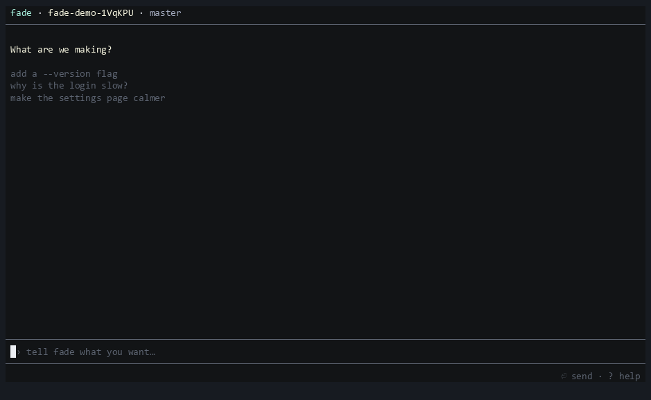

# Fade

**Plan the next thing while AI builds this one.**

<!-- Record this from `npm run demo` (or `fade --demo`) and save it as docs/assets/demo.gif -->


Fade is a terminal app with two AI agents working at the same time. The **Builder** writes code, one card at a
time. The **Companion** is a thinking partner: it reads your project, talks things through with you, and turns
the fuzzy idea into clear cards. You stay in the middle, keyboard only, and nothing steals your focus.

## Quick start

```bash
npm i -g @muzaffermahi/fade   # 1. install
fade login                    # 2. connect a model provider (Fade reuses Pi's login)
fade                          # 3. run it in any project folder
```

Want to look around first? `fade --demo` runs the whole UI in a temp folder with fake agents and no API calls.
Needs Node 22.19 or newer and git. Windows Terminal, macOS and Linux terminals all work.

## The mental model

Three things:

- **Builder** (left): takes the topmost *ready* card, builds it, and Fade commits the result.
- **Companion** (right): helps you decide what to build. It reads the project and writes cards. It never changes code.
- **Plan** (`PLAN.md`): the ordered list of cards, shared by everyone, editable by hand.

Five states:

```
·  draft     an idea being shaped
○  ready     you pressed Space; the Builder may take it
◌  building  the Builder is working on it
◆  review    finished; waiting for you to look
✓  done      you accepted it; it fades out of the list
```

Only you mark cards ready. When the Builder finishes, it makes a git commit, the card moves to *review*, and the
Builder takes the next ready card. Meanwhile you keep talking to the Companion and reviewing finished work.
Review a card, then **accept**, **revise** (it goes back on top with your note) or **undo** (Fade queues a card
that reverts it). Git is the undo button.

## Keys

| Key | Where | What it does |
|---|---|---|
| `Tab` / `Shift+Tab` | anywhere | focus Builder → Companion → Plan |
| `Enter` | Builder / Companion | send what you typed |
| `Esc` | Builder / Companion | stop the current card / reply |
| `Ctrl+R` | anywhere | open the first card waiting for review |
| `Ctrl+L` | anywhere | raw Builder log |
| `PageUp` / `PageDown` | Builder / Companion | scroll |
| `↑` `↓` (`k` `j`) | Plan | select |
| `Space` | Plan | mark ready / back to draft |
| `Enter` | Plan | open the card (review or edit) |
| `n` | Plan | new card |
| `Alt+↑` `Alt+↓` (`K` `J`) | Plan | move the card |
| `x` | Plan | drop the card |
| `a` `r` `u` | Plan / review | accept · revise · undo |
| `?` or `F1` | anywhere | help |
| `Ctrl+C` | anywhere | clear the input; press twice to quit |

If you type in the Builder box while it is idle, Fade turns it into a ready card on top of the plan. While it is
building, what you type is sent to it as a note.

## How PLAN.md works

```markdown
# Plan

## [building] Search
Search notes by title and body as you type.
Done when: typing "gro" shows "Groceries".

## [ready] Export to markdown
One .md file per note in ./export.

## [draft] Notebook styling
Warm paper, roomy margins, one column.

## Done
- Core notes app (a1b2c3d)
- Project setup
```

Each `## [state] Title` is a card; the text under it is the body. Edit the file by hand while Fade runs and it
picks the change up. Fade keeps its own bookkeeping (reviews, the Companion chat) in `.fade/`, which it keeps out
of your commits via `.git/info/exclude`.

## Models

Fade uses [Pi](https://github.com/earendil-works)'s model and credential setup, so whatever you logged into
works. To pick models, use `fade --builder provider/model --companion provider/model`, or put them in
`.fade/config.json`: `{ "builder": "...", "companion": "..." }`.

## Why

Code is cheap now. Clarity isn't.

When an AI can build almost anything in minutes, the slow part is knowing what to build next, and in what order,
and what "done" looks like. Most tools make you wait while the AI works, then hand you a pile of changes. Fade
flips that: the Builder is always busy with something you already decided, and you spend your time on the
thing only you can do, which is getting clear. A good card is a small, checkable promise, and cards are cheap to
write when you have a thinking partner who has read your code.

## Development

```bash
npm ci
npm run check      # typecheck
npm test           # unit + render tests
npm run snapshot   # prints headless renders of the key screens
npm run build      # compiles to dist/
```

`scripts/live-smoke.ts` runs one tiny card through the real Builder (it makes real model calls).

MIT licensed. See `THIRD_PARTY_NOTICES.md`.
